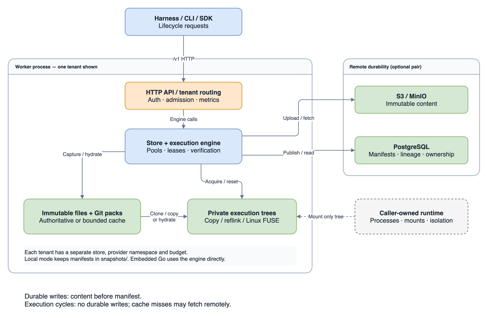

# Architecture

Ramet is a single-worker filesystem state engine for parallel agent attempts.
It stores an immutable base once, materializes isolated writable directories,
and validates each directory before reuse, with backend-specific byte verification. A caller supplies the sandbox and
controls processes; Ramet controls snapshot publication and workspace lifecycle.

This document describes Phase 2. See [implementation design](design.md) for
algorithms and invariants, [operations](operations.md) for configuration, and the
[product design](ramet-product-technical-design.md) for the longer-term direction.

## System boundary



[Editable diagram](images/architecture.drawio).

The HTTP API returns paths on the **worker's filesystem**. A remote Python or Go
client does not receive a copy of the workspace. A colocated runtime must mount
or otherwise access the chosen directory. Only that directory belongs inside
the workload; the worker's private content, metadata, and credentials do not.

There are three ways to use the same engine:

| Entry point | Deployment | Responsibility |
| --- | --- | --- |
| Embedded Go package | Caller opens `engine.Store` in its process | Caller manages store lifetime and supplies contexts |
| CLI and HTTP worker | `ramet serve` owns one store, or a credential-routed group of tenant stores | Server applies authentication, input bounds, deadlines, health, and metrics |
| Go HTTP client or Python SDK | Client calls the worker's `/v1` API | Client manages execution handles and runtime integration |

`RametEnv` is a callback-based environment adapter. It gives a harness reset,
step, state, and close operations without imposing a reward model or scheduler.
`Execution.run()` is a convenience for trusted commands on the same host; it
is not a sandbox.

## Runtime integration

For implementation scope, adapter code, and acceptance checks, start with the
[integration guide](integration.md).

Integrate Ramet at the point where your harness allocates a workspace for an
attempt. The framework keeps its existing agent loop, tool calls, and evaluation
logic. The runtime keeps responsibility for launching and isolating processes.

1. Capture a quiesced source directory on the worker, or import a Git revision,
   and create a pool from that snapshot.
2. Acquire an execution. Mount only its returned directory into the sandbox,
   and set the agent's working directory to that mount. Container images and
   files outside this mount are managed separately by the runtime.
3. Renew the execution lease while the attempt runs. Python execution contexts
   handle renewal; other callers must arrange it. The runtime must terminate
   workloads when ownership is lost, including when the harness crashes.
4. Evaluate the attempt through your framework. Before capture, promotion,
   reset, or release, stop writers and detach the runtime's workspace mount.
5. Promote a selected result and retain its snapshot ID in your application.
   Release each execution and close the pool when finished. Acquire from a new
   pool based on the saved snapshot to resume that state later.

The [Python Docker adapter](../sdk/python/README.md#docker-runtime) demonstrates
this contract with command execution and container cleanup. Custom container
or VM integrations need equivalent filesystem access and lifecycle handling;
Ramet does not provision VMs or expose workspaces as network volumes. A hosted
sandbox service must offer a way to attach the worker's workspace before it can
use this integration model. Connecting its controller to the HTTP API alone
is insufficient.

A laptop worker is useful for learning the API, testing an adapter, and trusted
local workloads. Worker-local filesystem access also remains part of a deployed
setup: optional remote storage changes snapshot durability, not where running
agents read and write files. The current alpha manages individual workers;
worker placement and sandbox scheduling belong to the caller.

## Components and code ownership

| Component | Main files | Responsibility |
| --- | --- | --- |
| Store | [store.go](../engine/store.go), [types.go](../engine/types.go) | Initialization, ownership, snapshots, pools, drain, GC, doctor, public models |
| Content engine | [content.go](../engine/content.go), [remote.go](../engine/remote.go) | Capture, manifests, durable publication, hydration, materialization, verification |
| Execution lifecycle | [pool.go](../engine/pool.go), [leases.go](../engine/leases.go) | Cohort reservation, reset, fork, release, quotas, fencing, expiry |
| Filesystem support | [internal/fsutil](../internal/fsutil) | APFS/Linux clones, copy fallback, syncing, atomic writes, locks, cleanup |
| Git profile | [git.go](../engine/git.go), [git_objects.go](../engine/git_objects.go) | Commit pinning, shared base/local object packs, offline reconstruction |
| Cache and preparation | [cache.go](../engine/cache.go), [preparation.go](../engine/preparation.go), [idle.go](../engine/idle.go) | Pinned LRU objects, headroom, idle limits, prefetch and warm slots |
| Lazy filesystem | [execution_fs.go](../engine/execution_fs.go), [internal/lazyfs](../internal/lazyfs) | Linux FUSE, namespace-first materialization, verified hydration on open |
| Provider contracts | [storage/storage.go](../storage/storage.go) | Immutable metadata and content interfaces |
| Durable providers | [storage/postgres](../storage/postgres), [storage/s3](../storage/s3) | PostgreSQL ownership/schema/lineage and S3-compatible objects |
| Worker interface | [internal/server](../internal/server), [cmd/ramet](../cmd/ramet), [internal/config](../internal/config) | HTTP routing, CLI, strict YAML and environment configuration |
| Clients | [client](../client), [sdk/python](../sdk/python) | HTTP bindings, context management, Python lease renewal |

The `engine` package owns state semantics. Providers persist records and bytes; they
do not implement execution scheduling. The HTTP layer translates requests and
errors and calls the same engine used by embedded applications.

## Storage modes

Both modes keep writable executions local. PostgreSQL metadata and S3 content
are an optional pair; the worker rejects configuring just one.

| State | Local mode | Remote durability mode |
| --- | --- | --- |
| Authoritative manifest and lineage | Local `snapshots/` JSON | PostgreSQL |
| Authoritative immutable file content | Local `objects/` | S3-compatible bucket/prefix |
| Materialization source | Local `objects/` | Verified local `objects/` cache |
| Pool definitions, active leases, idle slots | Process memory | Process memory |
| Writable execution directories | Local `executions/` | Local `executions/` |
| Recovery after losing the worker disk | Requires backup | New empty cache can hydrate published snapshots |

A data directory contains:

```text
worker-data/
  FORMAT                 local format marker, currently 1
  LOCK                   exclusive process lock
  REMOTE                 content-provider binding, remote mode only
  objects/<sha256>        immutable file bytes or remote cache entries
  snapshots/<id>.json     authoritative manifests in local mode
  staging/               temporary capture, Git, and hydration files
  executions/tree-*/     copy/reflink writable trees
  executions/lazy-*/     private backing tree and FUSE root mount
```

`REMOTE` prevents reopening a remote cache as a local store or with a different
content identity. Remote namespaces also bind to an endpoint, bucket, and prefix
in PostgreSQL. Enabling remote storage requires a fresh cache if the existing
store contains local manifests; this is not an automatic data migration.

## Durable path

Snapshot, checkpoint, and promotion are explicit publication operations.

1. Capture a quiesced source into content-addressed local objects and a manifest.
2. In remote mode, upload each referenced file object and wait for confirmation.
3. Publish the manifest atomically: a synced local file or a PostgreSQL record.
4. Return the immutable snapshot ID only after publication succeeds.

PostgreSQL stores schema version, namespace/content binding, and snapshot
records. A snapshot record contains its ID, parent ID, manifest bytes, and
creation time. Foreign keys protect parent lineage. The snapshot ID is the
SHA-256 of serialized manifest bytes. Regular files have a whole-file SHA-256;
small files name one object, while large files include an ordered list of
content-addressed chunks. Parents record lineage, not an incremental chain required to
reconstruct bytes: each manifest describes a complete selected tree.

Files of at least 8 MiB use content-defined chunks by default. Captures reuse
unchanged chunks; reconstruction checks every chunk and the complete file.
See [artifact checkpoints](artifact-checkpoints.md) for costs and configuration.

One PostgreSQL connection both holds the namespace advisory lock and performs
metadata operations. It never automatically reconnects after ownership loss.
Another worker can claim the namespace after that session ends, while the old
worker's durable operations fail. The tenant gateway routes bearer credentials to separate stores, roots,
metadata namespaces and content prefixes. It never trusts a tenant header or
request field to select storage. Provider credentials stay inside the worker.

## Execution path

Creating a pool reads and validates its immutable base. Acquisition reserves
capacity, prepares a local tree using the selected backend, and returns a lease.
The copy backend hydrates missing objects and verifies all bytes before return.
The Linux lazy backend exposes the namespace first and hydrates regular files
on first open. Git metadata and object packs are reconstructed eagerly. Missing-object downloads verify both digest and length
before becoming visible in the local cache.

Explicit prefetch hydrates and verifies content before scheduling. Pool warming
prepares idle trees without issuing leases; locality reports cached bytes and idle
trees to a caller making placement decisions. These are synchronous preparation
operations; placement and scheduling remain the caller's responsibility.

Warm acquire, reset, release, and local fork do not publish durable branches or
write remote content. Reset rebuilds from the pool's base; release performs that
reset before placing the slot in the idle set. Fork instead clones the current
execution's local state into another active slot. It still belongs to the same
pool, so resetting the fork returns it to the pool base.

APFS clonefile and Linux FICLONE share data extents where supported. Directory
entries and writable file inodes are independent. Unsupported volumes use full
copies unless `require_cow` is enabled. Full verification reads the resulting
tree; neither cloning nor recycling makes verification constant-time.

## Ownership and lifetime

A process lock protects each data directory. The remote metadata session adds
exclusive namespace ownership. These are separate from execution ownership,
which is represented by an unguessable lease token and generation number.

Execution leases expire and can be renewed. An expired slot is removed from
scheduling and destroyed; it is never recycled into another caller's attempt.
Pools, leases, and execution directories do not survive worker restart. Published
snapshots do. Startup removes abandoned staging and execution trees after it
establishes store ownership and checks the configured storage.

Lease fencing applies to API operations. It cannot stop a process holding an
open file descriptor or a workload that can access arbitrary host paths. The
runtime must enforce mount boundaries, stop writers before lifecycle changes,
and terminate workloads when ownership is lost.

## Operational surface

`/live` answers whether the HTTP handler is serving. `/ready` checks initialization,
drain, and configured provider reachability. `doctor` performs the expensive
content/lineage checks and filesystem clone probe separately. Metrics expose
lifecycle counts, failures, active/idle slots, and local/remote byte counters.

Drain rejects new pools, acquisitions, and forks while allowing existing holders
to finish. It does not terminate their processes. GC protects in-flight content
operations and deletes eligible unreferenced **local** objects; Ramet retains
remote objects. See [operations](operations.md) for shutdown and backup procedures.

## Tenant and resource boundaries

A gateway holds one independently owned `Store` per tenant. Tokens select stores;
identical content hashes do not grant access to another tenant's manifest or pool.
Each tenant has an execution/pool quota, request admission limit, remote cache
budget, idle budget, source-root allowlist and exact Git repository allowlist.
Health is public only at `/live`; gateway readiness and metrics require the
selected tenant's credential. SIGTERM drains every tenant.

The gateway isolates API state and managed capacity within one process. It does
not provide a hard CPU/memory boundary between tenant worker implementations.
Use separate worker processes/containers for that requirement. Workload runtimes
mount only one execution and enforce CPU, memory, process and network limits.
The Linux gate exercises that contract with a restricted Docker workload.

## Present limits

There is no distributed scheduler, cross-worker live-lease transfer, remote
object deletion, process-memory snapshot, or durable writable workspace API.
Lazy hydration is Linux-only, opt-in, and requires accessible `/dev/fuse` plus
`fusermount3` (or `fusermount`). It has independent writable inodes, not a shared
writable overlay. Reset still rebuilds the namespace. The copy backend remains
the portable default. See [validation](validation.md) for measured workloads;
those results do not establish the larger V1 scale targets or production SLOs.
